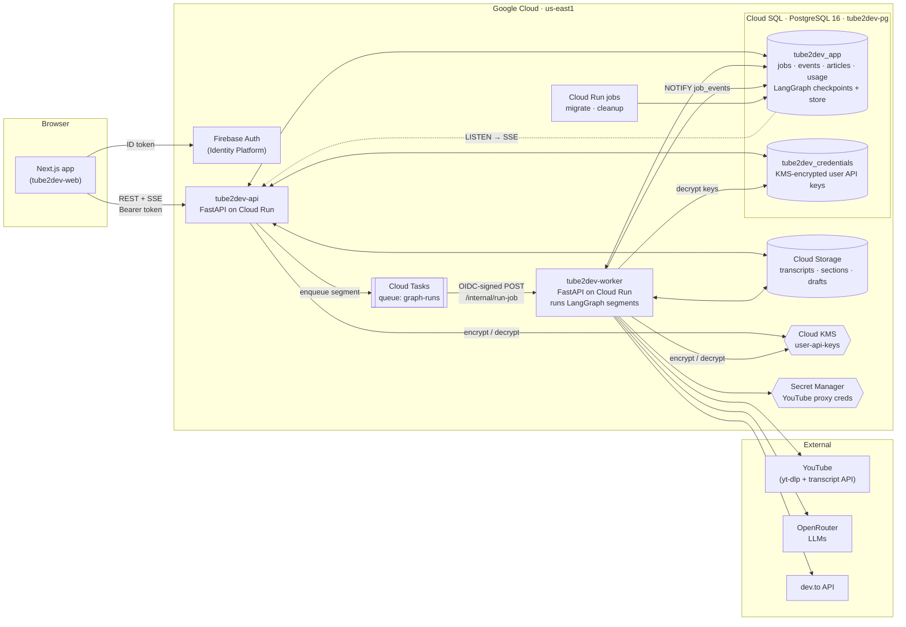
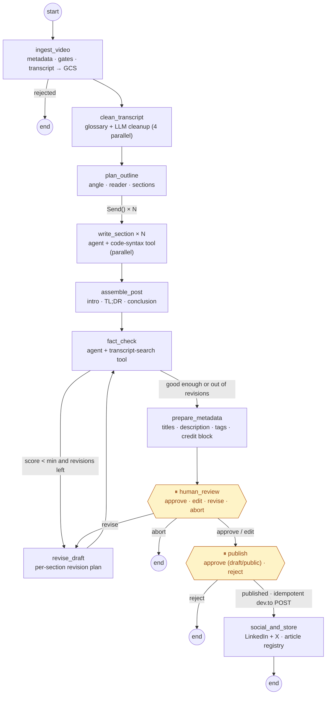
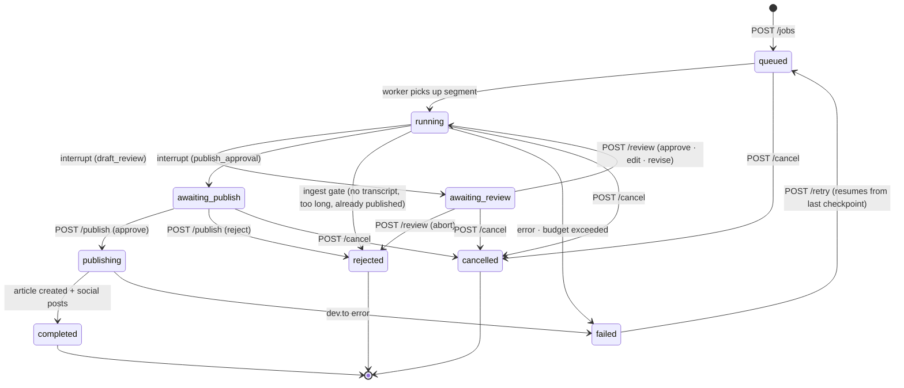
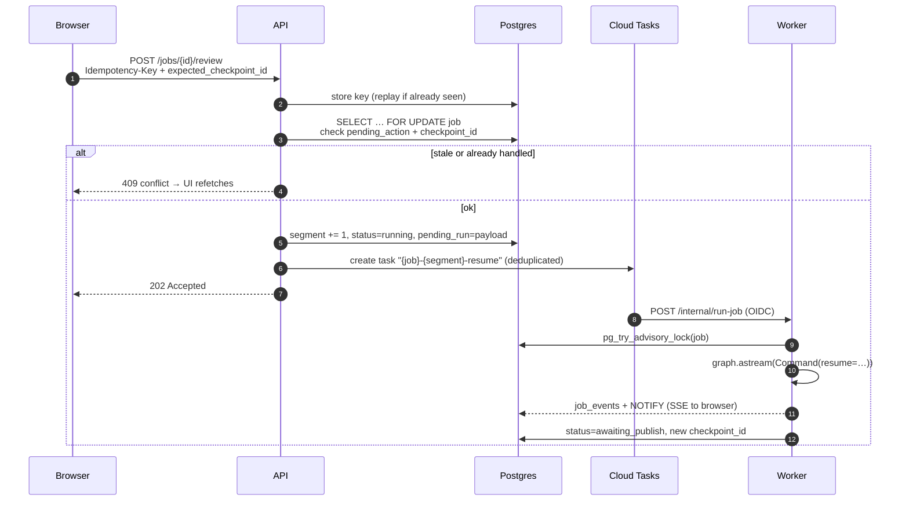
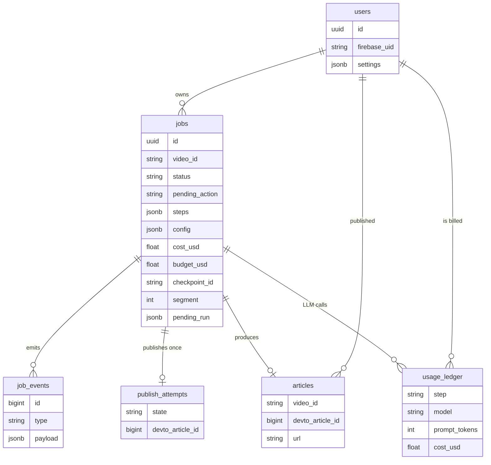

# Tube2Dev

**Turn a YouTube video into a dev.to blog post, and review every word before it goes out.**

Tube2Dev fetches a video's transcript and chapters. A LangGraph pipeline cleans the transcript, plans an
outline and writes the sections in parallel. It then fact-checks every important claim against the
transcript and revises automatically until the draft is faithful enough. Then it **pauses for you**:
you edit or approve the draft, then approve the dev.to publish (private draft or public). Finally it
writes LinkedIn and X posts for the new article.

Each user brings their own **OpenRouter** key (pays for the LLM) and **dev.to** key (publishes to their
account). The keys are encrypted with Cloud KMS, stored in a separate database, and never shown again.

| | |
|---|---|
| **Backend** | Python 3.13 · FastAPI · LangGraph (Postgres checkpointer + store) · LangChain · SQLAlchemy 2 (async, psycopg 3) · Alembic · uv |
| **Frontend** | Next.js 15 (App Router) · React 19 · TypeScript · Tailwind v4 · TanStack Query · Radix UI · CodeMirror 6 |
| **Cloud (GCP, us-east1)** | Cloud Run · Cloud SQL for PostgreSQL 16 · Cloud Storage · Cloud KMS · Cloud Tasks · Secret Manager · Firebase Auth · Cloud Build · Artifact Registry |
| **LLMs** | Any tool-calling model on OpenRouter (default `deepseek/deepseek-v4.1-flash`) |

---

## Contents

1. [Architecture](#architecture)
2. [The pipeline (LangGraph)](#the-pipeline-langgraph)
3. [Job lifecycle](#job-lifecycle)
4. [Repository layout](#repository-layout)
5. [Web app pages](#web-app-pages)
6. [API reference](#api-reference)
7. [Data model and storage](#data-model-and-storage)
8. [Security model](#security-model)
9. [Reliability and production behaviour](#reliability-and-production-behaviour)
10. [Logging and observability](#logging-and-observability)
11. [Configuration](#configuration)
12. [Running locally](#running-locally)
13. [Testing](#testing)
14. [GCP setup and deployment](#gcp-setup-and-deployment)
15. [Troubleshooting](#troubleshooting)

---

## Architecture



**How a request flows**

1. The browser signs in with Firebase and calls the API with the Firebase ID token.
2. Long work never runs inside a request. The API validates the job and enqueues a **graph segment**
   on Cloud Tasks, and the worker runs it. A segment runs from start or resume until the next human
   pause, or until the job ends.
3. As the graph runs, the worker writes progress rows to `job_events` and calls
   `pg_notify('job_events', <job_id>)`. The API holds one `LISTEN` connection per instance and streams
   the events to the browser over **Server-Sent Events**. Reconnecting with `Last-Event-ID` replays
   anything missed.
4. Large text (transcripts, sections, drafts) lives in **GCS**. LangGraph state only stores `gs://`
   references, so checkpoints stay a few KB.
5. All GCP access uses **Application Default Credentials (ADC)**: your user account locally, and each
   Cloud Run service's own service account in the cloud. There are no JSON key files anywhere.

> Locally (`TASK_MODE=inline`) the API runs graph segments in-process instead of using Cloud Tasks and
> the worker. The code path is otherwise identical.

---

## The pipeline (LangGraph)



| Node | What it does | LLM | Retries |
|---|---|---|---|
| `ingest_video` | Fetches metadata and chapters (yt-dlp) and the transcript (youtube-transcript-api), through a residential proxy if configured. **Gates:** no chapters and longer than 60 min, already published by this user, or no transcript. Splits the transcript by chapter (or 5-minute windows) and writes it to GCS. | – | 4× on YouTube blocking |
| `clean_transcript` | Builds a glossary from the title and description, then cleans each ≤2,500-word chunk (filler words, false starts, ASR mistakes, punctuation), 4 calls at a time. Writes `transcript/cleaned-*.json`. | ✓ | 3× |
| `plan_outline` | Picks the post's angle and target reader, groups chapters into 3–8 sections, suggests tags. | ✓ (structured) | 3× |
| `write_section` | One parallel branch per section (LangGraph `Send`). A `create_agent` writer with a `validate_code_syntax` tool checks Python and JSON code blocks. Uses the user's style profile and past reviewer feedback from the store. | ✓ (agent) | 3× |
| `assemble_post` | Keeps the sections verbatim and writes the intro, TL;DR bullets and conclusion. Saves draft rev N as JSON *parts* plus composed markdown. | ✓ | 3× |
| `fact_check` | An agent extracts 8–12 key claims and runs `search_transcript` for each one. The faithfulness score is **computed** (supported ÷ checked), not self-reported. | ✓ (agent) | 3× |
| `revise_draft` | Maps unsupported claims and notes to specific sections, revises only those sections in parallel, and rejects revisions that drop headings or code blocks. | ✓ | 3× |
| `prepare_metadata` | Writes 3 title options, a description (≤150 chars) and up to 4 tags, then adds the `` and attribution block. Saves the *final* revision. | ✓ | 3× |
| `human_review` | **Interrupt #1.** Waits for approve / edit / revise / abort. Revise feedback is remembered in the store for future posts. | – | – |
| `publish` | **Interrupt #2.** Waits for approve (private draft or public) or reject, then POSTs to dev.to through an idempotency ledger. | – | never automatic |
| `social_and_store` | Records the article and writes LinkedIn and X posts. A failure here never fails the job. | ✓ | 3× |

Transcript text is always wrapped in `<transcript>` / `<draft>` tags, and models are told to treat it
as data. The publish step contains **no LLM at all**, so content in a video can't steer it.

---

## Job lifecycle



**Resuming a paused job safely**



---

## Repository layout

```
youtube-to-blog/
├── backend/                     FastAPI API + worker, LangGraph pipeline (Python 3.13, uv)
│   ├── app/
│   │   ├── main_api.py          tube2dev-api: public FastAPI app (routers, CORS, lifespan)
│   │   ├── main_worker.py       tube2dev-worker: POST /internal/run-job (Cloud Tasks target, OIDC-verified)
│   │   ├── container.py         Builds every long-lived dependency once per process (DI + test overrides)
│   │   ├── cli.py               migrate · bootstrap-db · openapi · cleanup
│   │   ├── dev.py               Local dev server with auto-reload (selector event loop on Windows)
│   │   ├── core/
│   │   │   ├── config.py        pydantic-settings (all env vars, safety checks for local-only modes)
│   │   │   ├── logging.py       JSON logs for Cloud Logging, request/job/user ids, access-log middleware
│   │   │   ├── http.py          Error envelope + exception handlers
│   │   │   ├── errors.py        AppError, BudgetExceeded, NonRetryableError, …
│   │   │   └── aio.py           Windows-safe asyncio runner
│   │   ├── auth/firebase.py     Firebase ID-token verification (ADC) + dev auth for local use
│   │   ├── api/
│   │   │   ├── deps.py          current_user, owned_job (404 for other users' jobs), rate limiter
│   │   │   ├── schemas.py       Pydantic request/response models, the source of the OpenAPI spec
│   │   │   ├── serialize.py     DB rows → API models, cursors, dashboard progress labels
│   │   │   ├── jobflow.py       advance(): validate state → bump segment → enqueue (409 on races)
│   │   │   └── v1/              videos · jobs · review · articles · style_profiles · me · models · system
│   │   ├── graph/
│   │   │   ├── build.py         StateGraph wiring + retry policies
│   │   │   ├── state.py         BlogState (refs only, no large text)
│   │   │   ├── context.py       JobContext (runtime context, holds the decrypted keys, never checkpointed)
│   │   │   ├── nodes/           ingest · writing · quality · review · publish
│   │   │   ├── drafts.py        Draft "parts" ↔ markdown, versioning, revision validation
│   │   │   ├── prompts.py       All prompts (untrusted text always tag-wrapped)
│   │   │   ├── schemas.py       Structured-output models (Outline, FactCheck, RevisionPlan, …)
│   │   │   ├── tools.py         validate_code_syntax, search_transcript
│   │   │   ├── llm.py           Per-user ChatOpenRouter factory
│   │   │   ├── persistence.py   AsyncPostgresSaver + AsyncPostgresStore on a psycopg pool, strict msgpack
│   │   │   └── runner.py        Runs a segment, maps LangGraph task events to step state, recovery
│   │   ├── services/
│   │   │   ├── blobs.py         GCS / local / in-memory blob stores, content-addressed paths
│   │   │   ├── kms.py           Cloud KMS cipher (+ local AES-GCM for offline dev)
│   │   │   ├── credentials.py   Per-user key storage: verify → encrypt → separate DB
│   │   │   ├── youtube.py       yt-dlp + transcript API, proxy support, GCS cache
│   │   │   ├── devto.py         dev.to client (create, find-mine for idempotent retries)
│   │   │   ├── openrouter_models.py  Model catalogue (cached), per-video cost estimates
│   │   │   ├── tasks.py         Cloud Tasks dispatcher / in-process dispatcher
│   │   │   ├── events.py        job_events writer + LISTEN/NOTIFY fan-out for SSE
│   │   │   ├── usage.py         Token/cost callback + per-job budget enforcement
│   │   │   ├── idempotency.py   Idempotency-Key storage and replay
│   │   │   └── locks.py         Postgres advisory lock per job
│   │   └── db/
│   │       ├── models_app.py    users, jobs, job_events, articles, publish_attempts, usage_ledger, …
│   │       ├── models_creds.py  user_credentials (ciphertext only)
│   │       ├── repos.py         Postgres implementations of the graph's ports
│   │       ├── engines.py       Async engines (optional IAM-token auth)
│   │       └── iam.py           Cloud SQL IAM DB auth via ADC tokens
│   ├── migrations/              Two Alembic trees: app/ and creds/
│   ├── tests/                   Graph unit tests (scripted fake LLM) + API integration tests (testcontainers)
│   ├── Dockerfile               One image for api, worker, migrate and cleanup
│   ├── pyproject.toml / uv.lock
│   └── .env.example
├── frontend/                    Next.js 15 web app
│   ├── src/app/                 App Router pages (see "Web app pages")
│   ├── src/components/
│   │   ├── ui/                  Button, inputs, dialog/sheet, tabs, tooltip, popover, switch, slider
│   │   ├── common.tsx           StatusBadge, ScorePill, TimestampChip, ConfirmDialog, EmptyState, …
│   │   ├── shell.tsx            Sidebar, onboarding banner, offline/API-down banner, theme toggle
│   │   ├── jobs/                PipelineStepper, UsageMeter, ActivityLog, ModelPicker
│   │   ├── review/              MarkdownEditor (CodeMirror), MarkdownPreview (dev.to style), DraftDiff,
│   │   │                        FaithfulnessGauge, ClaimList, TitlePicker, TagInput, YouTubePlayer
│   │   └── settings/            KeyInputCard, StyleProfiles
│   ├── src/lib/
│   │   ├── api/                 Typed client (openapi-fetch + generated schema.d.ts), reachability store
│   │   ├── hooks/               TanStack Query hooks, useJobEvents (SSE), useResumeAction (safe resumes)
│   │   ├── auth.tsx             Firebase Auth (Google + email link) / dev auth
│   │   ├── logger.ts            Browser logger → /api/v1/client-logs (batched, redacted)
│   │   └── server-logger.ts     JSON logs from the Next.js server
│   ├── src/instrumentation.ts   Server start-up + onRequestError logging
│   ├── Dockerfile               Standalone Next.js image (type-check + tests + build)
│   └── .env.example
├── infra/
│   ├── bootstrap.sh             Creates every GCP resource + IAM (idempotent)
│   ├── cloudbuild.yaml          Build → test → push → migrate → deploy
│   └── local/init-dbs.sql       Creates the two databases in local Postgres
├── docs/
│   ├── implementation-plan.md   Design decisions, phases, GCP resource list
│   └── frontend-design-prompt.md  The UI brief the mockups were generated from
├── notebooks/                   The original single-notebook prototype
├── docker-compose.yml           Local containers → your real GCP resources (ADC)
├── docker-compose.offline.yml   Everything local: Postgres, local storage, dev auth
├── .env.example                 Compose variables for docker-compose.yml
└── .gitattributes / .gitignore
```

---

## Web app pages

The design is a calm developer tool: stone neutrals, a single indigo accent (`#5b5bd6`) reserved for
primary actions and live state, Geist and Geist Mono type, and dark mode. Status is always shown with a
glyph and a label as well as colour. Motion respects `prefers-reduced-motion`.

| Route | Page | What's on it |
|---|---|---|
| `/` | Landing | Three-step explainer and sign-in. Redirects to the dashboard when you're signed in. |
| `/login` | Sign in | Google sign-in, passwordless email link, and an animated transcript-to-post demo. In dev mode, any email signs in. |
| `/dashboard` | Dashboard | Stats (posts this month, average faithfulness, spend vs. monthly budget, jobs awaiting you); **Needs your attention** cards (review draft, approve publish, retry failed step); a jobs table with live rows, status filters with counts, search and pagination. |
| `/jobs/new` | New post | Paste any YouTube URL for an instant preview (thumbnail, chapters, transcript language). The **eligibility banner** shows an estimated cost or explains why the video can't be converted. Options: attribution, style profile, **model picker** (search, price and context filters, per-video cost estimate, over-budget warnings), and an Advanced section (max revisions, minimum faithfulness, budget). Also shows the daily quota. |
| `/jobs/[id]` | Live pipeline | A stepper mirroring the graph: parallel section sub-items, attempt badges, the fact-check ⇄ revise loop count, and per-step cost. Plus a paused banner, errors panel (retry from checkpoint, raise budget and retry), stall hint, usage meter, run config, draft versions, fact-check summary, activity log and the live/reconnecting/polling indicator. |
| `/jobs/[id]/review` | **Draft review** | Three columns. **Left:** YouTube player and outline with clickable timestamps. **Centre:** version picker, then Edit (CodeMirror) / Preview (dev.to style, unsupported claims highlighted, "Watch this part" links seek the player) / Diff. **Right:** faithfulness gauge, readability and structure scores, claims list, title picker, description, tags. A sticky action bar has Abort, Request revision (feedback sheet with quick chips) and Approve or Save edits & approve. Keyboard shortcuts: ⌘S, ⌘↵, ?. Edits autosave locally and there's an unsaved-changes guard. Tabs replace the columns on mobile. |
| `/jobs/[id]/publish` | Publish approval | Summary (title, tags, description, length, attribution), a final-draft side sheet, and a choice between **private draft** (recommended) or **public**. Public requires typing `publish`. Reject takes a reason. Retries are safe (no duplicate articles). |
| `/jobs/[id]/result` | Result | dev.to link with Draft/Public badge; run summary (time, cost, tokens, revisions, faithfulness); editable LinkedIn and X posts with character counts, Copy and Regenerate. |
| `/articles` | Articles | Grid of everything you've published, linking to dev.to, the video and the job. |
| `/settings` | Settings | Tabs. **Integrations:** OpenRouter and dev.to key cards (write-only input, Save & verify, Test connection, Disconnect, showing "connected · …last4 · @username"). **Defaults:** default model with per-post estimates, attribution, revisions, faithfulness, budgets. **Style profiles.** **Account:** profile, sign out, and delete account (type your email to confirm). |
| `/settings/style-profiles` | Style profiles | Create, edit and delete voice profiles (1–3 example posts) and pick a default. |
| `/usage` | Usage | 7/30/90-day KPIs, a daily cost chart, a per-model breakdown and the daily quota meter. |

App-wide behaviour:
- An onboarding banner blocks new posts until both API keys are connected.
- A "Can't reach the Tube2Dev server" banner shows when the API is unreachable, and everything
  refetches when it's back.
- Unknown routes get a 404 page; render errors are caught by an error boundary and reported to the
  logger.

---

## API reference

- **Base URL:** `/api/v1`. Interactive docs are at **`/docs`** on the API (disabled in prod).
- **Auth:** `Authorization: Bearer <Firebase ID token>`. In local dev mode, use `Bearer dev:<email>`.
- **Errors** always use the same envelope, plus an `X-Request-ID` header:
  ```json
  { "error": { "code": "stale_checkpoint", "message": "This job changed since you loaded it.", "details": {} } }
  ```
- **Resume endpoints** (review, publish, cancel, retry) require an `Idempotency-Key` header. Repeating
  a request replays the first response. Review and publish also take `expected_checkpoint_id` and return
  **409** if the job has moved on.

| Status | Codes you'll see |
|---|---|
| 400 | `idempotency_key_required` |
| 401 | `unauthorized`, `token_expired` |
| 404 | `not_found` (also for other users' jobs, so their existence isn't revealed) |
| 409 | `stale_checkpoint`, `not_pending`, `invalid_status`, `already_published`, `job_running`, `not_retryable` |
| 412 | `keys_missing` |
| 422 | `validation_error` (with `details.fields`), `invalid_url`, `invalid_model`, `invalid_key`, `budget_too_high` |
| 429 | `rate_limited`, `quota_exceeded` (with `Retry-After`) |
| 503 | `dispatch_failed`, `job_busy` |

### Videos
| Method | Path | Description |
|---|---|---|
| `POST` | `/videos/preview` | `{url}` → title, channel, thumbnail, duration, chapters, transcript language, `eligible` / `ineligible_reason` (`no_transcript`, `too_long_without_chapters`, `already_published`, `fetch_blocked`, `not_found`, `age_restricted`), estimated cost range. |

### Jobs
| Method | Path | Description |
|---|---|---|
| `POST` | `/jobs` | `{video_url, attribution_mode, style_profile_id?, model?, max_revisions, min_faithfulness, budget_usd?}` → **202** `{job_id, status}`. Checks keys (412), daily quota (429), already published (409) and model (422). |
| `GET` | `/jobs` | `?status=all\|in_progress\|needs_you\|completed\|failed\|rejected&q=&cursor=&limit=` → `{items, next_cursor, counts}` |
| `GET` | `/jobs/{id}` | Full detail: steps (with sub-items, attempts, cost), config, usage by step, errors, `pending_action`, `checkpoint_id`, current draft rev, dev.to URL. |
| `GET` | `/jobs/{id}/events` | **SSE.** Events: `status_changed`, `step_started`, `step_finished`, `step_failed`, `sub_item_update`, `interrupt`, `usage`, `heartbeat` (every 15s). Supports `Last-Event-ID` / `?after=`. |
| `POST` | `/jobs/{id}/cancel` | Stops after the current step, or immediately if paused. |
| `POST` | `/jobs/{id}/retry` | `{budget_usd?}`: resume a failed job from its last checkpoint. |
| `DELETE` | `/jobs/{id}` | Deletes the job, its checkpoints and its GCS objects (409 while running). |

### Drafts and quality
| Method | Path | Description |
|---|---|---|
| `GET` | `/jobs/{id}/drafts` | Versions: `[{rev, kind: auto\|revised\|human_edit\|final, sha256, char_count, created_at, note}]` |
| `GET` | `/jobs/{id}/drafts/{rev}` | `{rev, kind, markdown}` (served from GCS) |
| `GET` | `/jobs/{id}/outline` | Angle, target reader, sections with timestamps and key points |
| `GET` | `/jobs/{id}/fact-check` | Faithfulness score, threshold, quality scores, claims (supported, evidence, section, timestamp), revision notes |

### Human-in-the-loop
| Method | Path | Description |
|---|---|---|
| `GET` | `/jobs/{id}/review` | The draft-review payload: rev, title and options, description, tags, scores, unsupported claims, outline, `checkpoint_id` |
| `POST` | `/jobs/{id}/review` | `{action: approve\|edit\|revise\|abort, title?, tags?, description?, markdown?, feedback?, expected_checkpoint_id}`. For `edit`, the markdown is written to GCS and only its reference resumes the graph. |
| `GET` | `/jobs/{id}/publish-request` | Title, tags, description, body length, final rev, dev.to `@username`, attribution, `checkpoint_id` |
| `POST` | `/jobs/{id}/publish` | `{decision: approve\|reject, published: bool, message?, expected_checkpoint_id}` |
| `GET` | `/jobs/{id}/result` | dev.to URL and status, social posts, run summary |
| `POST` | `/jobs/{id}/social/regenerate` | New LinkedIn and X posts |

### Articles, style profiles, account
| Method | Path | Description |
|---|---|---|
| `GET` | `/articles` | `?q=&cursor=`: published articles |
| `GET` / `POST` | `/style-profiles` | List / create `{name, examples[1..3], is_default}` |
| `PUT` / `DELETE` | `/style-profiles/{profile_id}` | Update / delete |
| `GET` | `/me` | Profile + settings |
| `DELETE` | `/me` | `{confirm_email}`: deletes all your data, keys, checkpoints and GCS objects (dev.to articles stay) |
| `GET` / `PUT` | `/me/settings` | Default model, attribution, revisions, faithfulness, per-job and monthly budget, default style profile |
| `GET` | `/me/integrations` | `{openrouter, devto}` → `connected`, `last4`, `status`, `verified_at`, `username`. **Never** the key. |
| `PUT` | `/me/integrations/{provider}` | `{api_key}`: verified with the provider, then KMS-encrypted and stored |
| `POST` | `/me/integrations/{provider}/test` | Re-verify a stored key |
| `DELETE` | `/me/integrations/{provider}` | Disconnect |
| `GET` | `/me/usage` | `?period=7d\|30d\|90d` → totals, daily series, per-model breakdown, quota |
| `GET` | `/me/dashboard` | Dashboard stats + quota |

### Models and system
| Method | Path | Description |
|---|---|---|
| `GET` | `/models` | Tool-calling OpenRouter models (`:batch` endpoints excluded). `?q=&max_price_mtok=&min_context=&used_before=&sort=price\|context\|name&video_id=&budget_usd=` → price per Mtok, context length, **estimated cost** for that video (or your average post), `over_budget`, `used_before`, `is_default`. |
| `POST` | `/client-logs` | Browser log sink: unauthenticated, rate-limited per IP, scrubbed of secrets |
| `GET` | `/healthz` · `/readyz` | Liveness · readiness (checks both databases) |
| `POST` | `/internal/run-job` | **Worker only.** Cloud Tasks target; requires an OIDC token from `sa-tasks-invoker`. |

The typed frontend client is generated from this spec:

```bash
cd backend && uv run python -m app.cli openapi --out openapi.json
cd ../frontend && npm run gen:api        # → src/lib/api/schema.d.ts
```

---

## Data model and storage



| Where | What |
|---|---|
| **`tube2dev_app`** (Cloud SQL) | The tables above, plus `idempotency_keys` and `model_cache`. Also LangGraph's `checkpoints*` tables (graph state per job, `thread_id = job_id`) and `store` table (namespaces `("users", uid, "style_profiles")` and `("users", uid, "feedback")`). |
| **`tube2dev_credentials`** (Cloud SQL, separate DB) | `user_credentials(user_id, provider, ciphertext, kms_key_version, last4, status, username)`. Only the API and worker accounts can connect. |
| **GCS bucket** | `users/{uid}/jobs/{job}/transcript/…json`, `sections/…md`, `drafts/r{rev}-{kind}-{sha12}.md`, `human_edit/…md`, plus `cache/videos/{id}/` for YouTube metadata and transcripts. Objects are **content-addressed** (hash in the name), so a retried node never overwrites anything. Lifecycle rules delete old objects. |
| **LangGraph state** | Only references (`{uri, sha256, size}`), small metadata and scores. A typical checkpoint is under 20 KB. |

---

## Security model

- **Per-user API keys:**
  - Verified with the provider when saved.
  - Encrypted with **Cloud KMS**, with additional authenticated data `user_id:provider`, so a
    ciphertext copied to another user or provider won't decrypt.
  - Stored in a **separate database** that only `sa-api` and `sa-worker` can reach.
  - Never returned by the API; only `last4` is shown.
- **Keys never reach checkpoints:**
  - Decrypted keys go into LangGraph's **runtime context**, which isn't checkpointed. They are never
    in graph state, `configurable`, run metadata or logs.
  - Checkpoint deserialization is restricted to a safe-type allowlist (`JsonPlusSerializer(allowed_msgpack_modules=None)`),
    so a tampered checkpoint can't execute code.
- **Authentication and authorization:**
  - Firebase ID tokens are verified on every request.
  - Every job query is scoped to the caller; other users' jobs return 404.
  - The worker accepts only OIDC tokens from `sa-tasks-invoker`, with Cloud Run IAM in front.
- **GCP access:** ADC everywhere, no service-account key files. Each Cloud Run service has its own
  least-privilege service account. Cloud SQL uses IAM database authentication (no passwords).
- **Prompt injection:** transcripts and descriptions are wrapped and marked as data; nothing that reads
  them can publish.
- **Logs are scrubbed:** secret-looking values are redacted on both the backend and the browser.
- **Local-only shortcuts are guarded:** dev auth, inline tasks, local storage and the local cipher are
  refused unless `ENV=local`.

---

## Reliability and production behaviour

| Concern | How it's handled |
|---|---|
| Long-running work | Each segment is a Cloud Task (30-minute deadline, retries with backoff). Task names are deterministic (`{job}-{segment}-{kind}`), so duplicates are dropped. |
| Worker crash mid-run | Cloud Tasks redelivers, and the runner continues from the **last checkpoint** rather than restarting. Locally, the API re-dispatches `jobs.pending_run` on startup. |
| Two workers on one job | A Postgres advisory lock per job; the second worker returns 503 and Cloud Tasks retries later. |
| Double-clicked Approve | `Idempotency-Key` replay, a row lock, the `expected_checkpoint_id` check and the segment counter. |
| Duplicate dev.to posts | A `publish_attempts` ledger. A retry after a crash first looks up your existing articles, then POSTs only if nothing landed. Publish is never retried automatically. |
| Flaky LLMs | 90-second per-call timeout, per-node `RetryPolicy` (3 attempts with backoff), budget and validation errors never retried. A stall warning shows in the UI after 2 minutes. |
| Runaway cost | A usage callback records every call (OpenRouter-reported cost) and blocks new calls once the job budget is spent. The user can raise the budget and retry. |
| YouTube blocking cloud IPs | Residential proxy via Secret Manager (Webshare), results cached in GCS, "fetch blocked" reported as retryable. |
| Long-video revisions | Revisions are per section and validated (headings and code blocks must survive), instead of one huge rewrite. |
| Retention | The daily `cleanup` job purges checkpoints and blobs of old or abandoned jobs, prunes events and idempotency keys, and fails stalled jobs (so they can be retried). |
| Quotas | Daily jobs per user, a per-user rate limit, and a budget cap per job. |

---

## Logging and observability

- **Backend:**
  - One JSON object per line, in the shape Cloud Logging expects (`severity`, `message`,
    `logging.googleapis.com/trace`), with `request_id`, `job_id` and `user_id` attached automatically.
  - One structured access-log line per request (method, path, status, latency).
- **Frontend (browser):**
  - `lib/logger.ts` batches `info`/`warn`/`error` entries to `/api/v1/client-logs`, where they're
    re-emitted as `source=frontend`.
  - Uncaught errors, unhandled rejections and React error boundaries are captured; secrets are
    redacted before anything leaves the browser.
  - Entries are buffered with backoff while the API is down.
- **Frontend (server):** `instrumentation.ts` logs start-up and every server-side request error as
  JSON.
- **Per-job telemetry:** the `usage_ledger` holds tokens and cost per step and model (it powers the
  usage page), and `job_events` is the activity log.
- **Optional:** LangSmith tracing via the `LANGSMITH_*` env vars.

---

## Configuration

Backend settings (env vars, see `backend/.env.example`):

| Variable | Default | Purpose |
|---|---|---|
| `ENV` | `local` | `local` · `stage` · `prod`. Local-only modes are refused outside `local`. |
| `GCP_PROJECT`, `REGION` | –, `us-east1` | Project and region |
| `APP_DB_URL`, `CREDS_DB_URL` | local Postgres | `postgresql+psycopg://<user>@<host>/<db>` |
| `DB_IAM_AUTH` | `false` | `true` on Cloud Run: an ADC token is used as the DB password |
| `DB_MIGRATE_ROLE` | – | Run migrations as this role (`SET ROLE`), e.g. `sa-migrate@P.iam` |
| `DB_APP_GRANTEES`, `DB_CREDS_GRANTEES` | – | IAM DB users the migrate step grants runtime access to |
| `GCS_BUCKET` / `BLOB_BACKEND` | – / `gcs` | Content bucket; `local` for offline dev |
| `KMS_KEY_NAME` / `CIPHER_BACKEND` | – / `kms` | Key for user API keys; `local` (AES-GCM) for offline dev |
| `TASK_MODE` | `inline` | `cloud_tasks` in the cloud |
| `TASKS_QUEUE`, `TASKS_INVOKER_SA`, `WORKER_URL` | | Cloud Tasks wiring |
| `AUTH_MODE`, `FIREBASE_PROJECT_ID` | `firebase` | `dev` accepts `Bearer dev:<email>` (local only) |
| `WEB_ORIGINS` | `http://localhost:3000` | CORS allow-list (comma-separated) |
| `YT_PROXY_SECRET` / `YT_PROXY_URL` | – | Webshare credentials secret, or a plain proxy URL |
| `DEFAULT_MODEL` | `deepseek/deepseek-v4.1-flash` | |
| `LLM_TIMEOUT_SECONDS`, `LLM_MAX_RETRIES` | `90`, `1` | Per-call limits |
| `DEFAULT_BUDGET_USD`, `MAX_BUDGET_USD`, `DAILY_JOB_QUOTA`, `RATE_LIMIT_PER_MINUTE` | `0.5`, `20`, `10`, `120` | Limits |
| `MAX_NO_CHAPTER_DURATION`, `WINDOW_SECONDS` | `3600`, `300` | Ingest gates and chunking |
| `CHECKPOINT_RETENTION_DAYS`, `ABANDONED_JOB_DAYS` | `30`, `14` | Cleanup |

Frontend settings (`NEXT_PUBLIC_*`, inlined at build time, see `frontend/.env.example`):
`NEXT_PUBLIC_API_BASE_URL`, `NEXT_PUBLIC_AUTH_MODE` (`firebase` | `dev`), `NEXT_PUBLIC_RELEASE`,
`NEXT_PUBLIC_FIREBASE_API_KEY`, `NEXT_PUBLIC_FIREBASE_AUTH_DOMAIN`, `NEXT_PUBLIC_FIREBASE_PROJECT_ID`,
`NEXT_PUBLIC_FIREBASE_APP_ID`.

---

## Running locally

Prerequisites: **Docker Desktop**. For working without Docker you also need **uv** (Python 3.13) and
**Node 22**.

### A. Fully offline (no GCP account needed)

Local Postgres, a local volume instead of GCS, a local AES key instead of KMS, and dev sign-in.
YouTube, OpenRouter and dev.to are the real services.

```bash
docker compose -f docker-compose.offline.yml up --build
```

- Web: <http://localhost:3000> (sign in with any email)
- API docs: <http://localhost:8000/docs>
- Paste your OpenRouter and dev.to keys under **Settings → Integrations**, then create a post.
- `docker compose -f docker-compose.offline.yml down` stops it (add `-v` to wipe the data).

### B. Local containers against your real GCP resources

Prerequisites: the resources from [GCP setup](#gcp-setup-and-deployment) exist, and the one-time
`bootstrap-db --dev-user` step is done.

```bash
gcloud auth application-default login \
  --scopes=https://www.googleapis.com/auth/cloud-platform,https://www.googleapis.com/auth/sqlservice.login
gcloud auth application-default set-quota-project <project-id>

cp .env.example .env                  # GCP_PROJECT, CLOUD_SQL_INSTANCE, DB_IAM_USER (you%40gmail.com), GCLOUD_CONFIG_DIR, Firebase
cp backend/.env.example backend/.env  # GCS_BUCKET, KMS_KEY_NAME, AUTH_MODE, FIREBASE_PROJECT_ID
docker compose -f docker-compose.offline.yml down   # frees port 5432 if the offline stack is running
docker compose up --build
```

What runs:
- `cloudsql-proxy`, the Cloud SQL Auth Proxy with `--auto-iam-authn`, logged in as you.
- `migrate`, which runs migrations as you switched into the `sa-migrate` role, so tables are owned
  correctly.
- `api`, with graph segments run inline.
- `web`.

Data goes to the real Cloud SQL, GCS and KMS.

### C. Without Docker (hot reload)

```bash
# Backend: needs a Postgres, e.g. `docker compose -f docker-compose.offline.yml up -d postgres`
cd backend
uv sync
uv run python -m app.cli migrate
uv run python -m app.dev               # http://localhost:8000 (auto-reload; uses backend/.env)

# Frontend
cd frontend
cp .env.example .env.local             # NEXT_PUBLIC_AUTH_MODE=dev for local
npm install
npm run dev                            # http://localhost:3000
```

---

## Testing

```bash
cd backend
uv run ruff check app tests migrations
uv run pytest                          # graph unit tests + API integration tests (integration needs Docker)

cd ../frontend
npm run typecheck
npm test
```

- **Graph unit tests** use a scripted fake chat model that supports tool binding and structured output.
  They cover:
  - the full run through both human pauses, and the revision loop;
  - edit, revise, abort and reject;
  - the ingest gates;
  - the budget limit;
  - **no duplicate dev.to post after a crash mid-publish**;
  - checkpoints containing no text and no keys.
- **Integration tests** start a real Postgres (testcontainers), run the migrations and drive the real
  FastAPI app, with only GCS, KMS, YouTube, OpenRouter and dev.to faked. They cover:
  - keys, preview, the model picker and the whole review/publish flow;
  - idempotent replay, 409 on a stale checkpoint and authorization;
  - quotas and restart recovery.
- **Frontend tests:** formatting helpers, tag rules, routing, and logger redaction and resilience.

---

## GCP setup and deployment

**Prerequisites:** the gcloud CLI (`winget install Google.CloudSDK` on Windows), a project with billing
enabled, and `gcloud auth login`.

**1. Create the resources.** The script is idempotent. It takes about 15 minutes, mostly Cloud SQL,
which bills about $10–15 a month while it runs.

```bash
PROJECT=<project-id> ./infra/bootstrap.sh
```

| Resource | Name |
|---|---|
| APIs | Cloud Run, Cloud SQL Admin, Storage, KMS, Secret Manager, Cloud Tasks, Scheduler, Artifact Registry, Cloud Build, IAM, Identity Toolkit, Logging/Monitoring/Trace/Error Reporting |
| Cloud SQL | `tube2dev-pg` (Postgres 16, IAM auth, backups + point-in-time recovery, deletion protection) with databases `tube2dev_app` and `tube2dev_credentials` |
| Cloud Storage | `<project>-tube2dev-content` (private, uniform access, lifecycle rules) |
| Cloud KMS | key ring `tube2dev`, key `user-api-keys` (90-day rotation) |
| Secret Manager | `postgres-password`, `yt-proxy-credentials`, `langsmith-api-key` |
| Cloud Tasks | queue `graph-runs` |
| Artifact Registry | `tube2dev` (Docker) |
| Service accounts | `sa-api`, `sa-worker`, `sa-tasks-invoker`, `sa-migrate`, `sa-web`, `sa-build`, each with least-privilege roles |

**2. One-time database handover.** This makes `sa-migrate` own both databases, revokes public access,
and lets your account migrate and run locally:

```bash
./cloud-sql-proxy.x64.exe --port 5432 <project-id>:us-east1:tube2dev-pg &
POSTGRES_PASSWORD="$(gcloud secrets versions access latest --secret=postgres-password)" \
  uv run --directory backend python -m app.cli bootstrap-db \
  --migrate-user "sa-migrate@<project-id>.iam" --dev-user "<your-google-email>"
```

**3. Firebase Auth:**
1. In the Firebase console, add Firebase to the project.
2. Enable **Google** and **Email link** sign-in.
3. Add a Web app and copy its `apiKey` and `appId`.
4. Add `localhost` and `tube2dev-web-<project-number>.us-east1.run.app` to the authorized domains.

**4. Optional: YouTube proxy.** Recommended for Cloud Run, which YouTube tends to block:

```bash
echo -n '{"username":"…","password":"…"}' | gcloud secrets versions add yt-proxy-credentials --data-file=-
```

**5. Deploy.** Cloud Build builds and tests both images, pushes them, runs the `tube2dev-migrate` job,
and deploys `tube2dev-worker`, `tube2dev-api`, `tube2dev-web` and the `tube2dev-cleanup` job:

```bash
gcloud builds submit --config infra/cloudbuild.yaml \
  --substitutions=_DEV_USERS=<your-email>,_FIREBASE_API_KEY=<apiKey>,_FIREBASE_APP_ID=<appId>
```

**6. After the first deploy:**
- Allow Cloud Tasks to invoke the worker (`roles/run.invoker` for `sa-tasks-invoker`).
- Create the daily Cloud Scheduler trigger for `tube2dev-cleanup`.

The exact commands for both are printed at the end of `bootstrap.sh`.

---

## Troubleshooting

| Symptom | Likely cause and fix |
|---|---|
| A step sits at "No response from the model" | Slow or overloaded model, or an OpenRouter outage. Calls time out after 90s and retry automatically. Cancel and pick a faster model if it persists. `:batch` models are hidden because they answer asynchronously. |
| Preview says "YouTube temporarily blocked the request" | Common from cloud IPs. Configure `yt-proxy-credentials`, or retry. |
| `412 keys_missing` | Connect both keys under **Settings → Integrations**. |
| `402` / "Job budget reached" | Open the job and use **Raise budget & retry**. It continues from the checkpoint and finished steps aren't re-billed. |
| `409 This job changed since you loaded it` | Someone or something already advanced the job. The UI refetches; just act on the new state. |
| "Can't reach the Tube2Dev server" banner | The API is down or restarting. Running jobs resume from their checkpoint when it's back. |
| `cloudsql-proxy` permission errors locally | Re-run `gcloud auth application-default login` with the `sqlservice.login` scope, and make sure `bootstrap-db --dev-user <you>` was run. |
| Windows: psycopg "ProactorEventLoop" error | Use `uv run python -m app.dev`, which forces the selector event loop. |

---

## How to run this project (quick start)

Pick the path that matches what you have. All commands run from the repo root.

**1. Just try it: no cloud account, about 5 minutes.** You need Docker Desktop, an OpenRouter key and a
dev.to key.

```bash
git clone https://github.com/ssd713092000-star/youtube-to-blog.git
cd youtube-to-blog
docker compose -f docker-compose.offline.yml up --build
```

Then:
1. Open <http://localhost:3000> and sign in with any email.
2. Go to **Settings → Integrations** and paste your OpenRouter and dev.to keys.
3. **New post** → paste a YouTube link → **Start writing**.
4. Watch the pipeline, then review the draft → approve → choose private draft or public → done.

**2. Develop with hot reload.** You need Docker, uv and Node 22.

```bash
docker compose -f docker-compose.offline.yml up -d postgres          # database only
cd backend && uv sync && uv run python -m app.cli migrate && uv run python -m app.dev
# in a second terminal:
cd frontend && cp .env.example .env.local && npm install && npm run dev
```

**3. Local containers on your real GCP resources.** First do steps 1–3 of
[GCP setup](#gcp-setup-and-deployment), then:

```bash
gcloud auth application-default login --scopes=https://www.googleapis.com/auth/cloud-platform,https://www.googleapis.com/auth/sqlservice.login
cp .env.example .env && cp backend/.env.example backend/.env       # fill in your project values
docker compose up --build
```

**4. Run it in the cloud.** Finish [GCP setup and deployment](#gcp-setup-and-deployment) (steps 1–6).
The web app is then at `https://tube2dev-web-<project-number>.us-east1.run.app`.

| I want to… | Command |
|---|---|
| Stop the offline stack | `docker compose -f docker-compose.offline.yml down` |
| Wipe local data | `docker compose -f docker-compose.offline.yml down -v` |
| See API logs | `docker compose -f docker-compose.offline.yml logs -f api` |
| Run all tests | `cd backend && uv run pytest` · `cd frontend && npm test` |
| Regenerate the typed API client | `cd backend && uv run python -m app.cli openapi --out openapi.json && cd ../frontend && npm run gen:api` |
| Run retention cleanup | `cd backend && uv run python -m app.cli cleanup` |

---

<sub>Started as the single LangGraph notebook in `notebooks/yt_to_devto_langgraph.ipynb`.
`docs/implementation-plan.md` records the design decisions behind turning it into this service.</sub>
